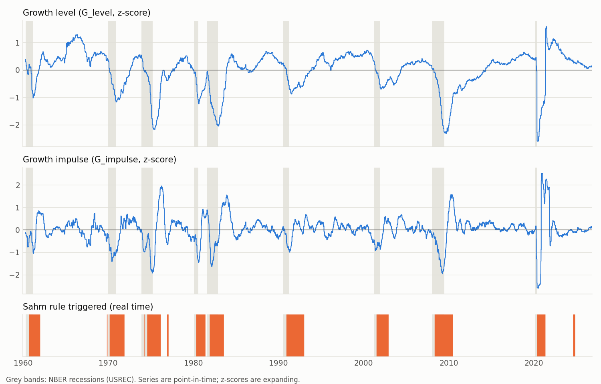
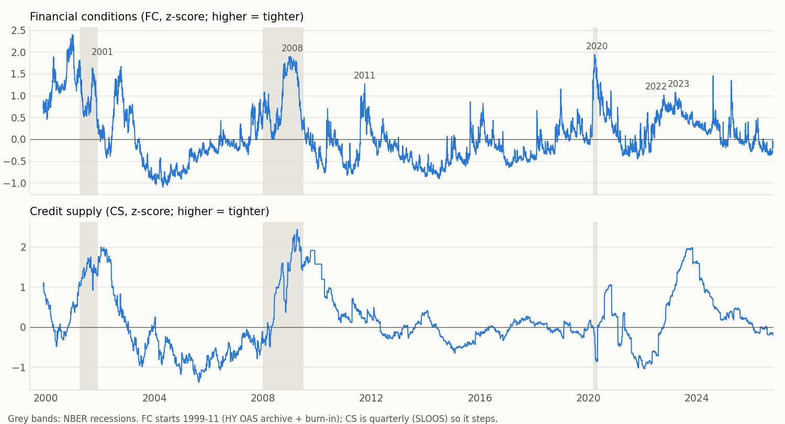
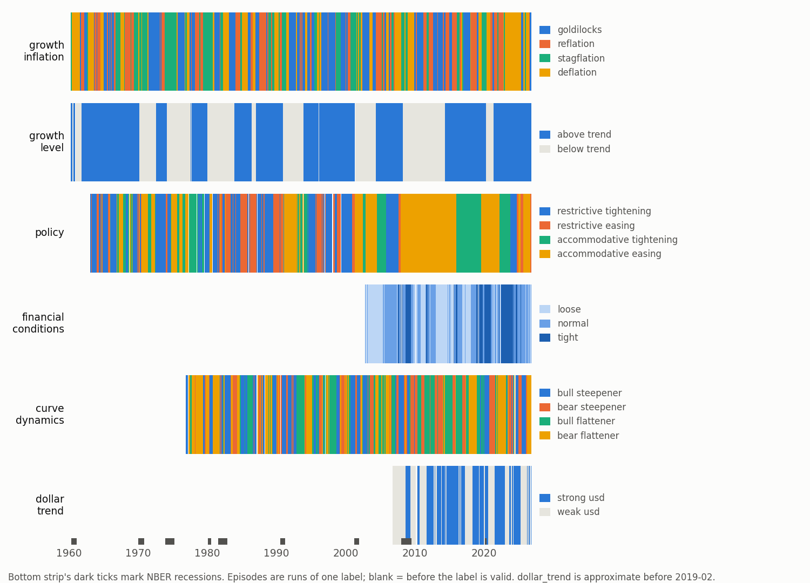

# Macro state v1 — validation (C8)

**Status:** for the researcher to read. Nothing here changes a definition; section 8 lists the changes I'd propose and why.
**Definitions:** `docs/research/macro_state_definitions_v1.md` (frozen `a1445a1`, 2026-10-24).
**Code checked:** `06cdedc` (state), `2984b5b` (rates), `d2fcc8a` + `e452b2b` (market, dollar), `81dfaab` (regimes, flags), `ad25a59` (ledger).
**Data as of:** 2026-10-23. Every number below comes from `scripts/macro_state_validation.py`.
**No asset returns were used** (plan step C8.1). Everything is compared with NBER recessions (`USREC`), known episodes, other vintages of the same data, and the state's own history.
**File name:** the plan called this `macro_state_v1.md`; the repo's guard treats any `docs/research/*_v<N>.md` as a frozen definitions file, so it is named `macro_state_validation.md`. Figures are in `docs/research/macro_state_v1/`.

## 1. Verdict in one table

| Question | Answer | Where |
|---|---|---|
| Does the growth state track recessions? | Yes. `G_impulse` AUC 0.90 against `USREC`, `G_level` 0.78. `G_level` is below 0 on 46–100% of days in 8 of 9 recessions (27% in the two-month 2020 one) | §2 |
| Does the Sahm flag work as a real-time flag? | It fires in all 9 recessions: 91–131 days after the NBER start in five of them, 68 days in 2020, 55 days *before* the start in 1970, and in 1981 it is still on from the 1980 run. It also fires twice outside a recession (1976-77, 2024) | §2 |
| Do financial conditions and credit supply light up in the known stress episodes? | Yes: `FC` peaks at the 91st–99th percentile of its history in 2001, 2008, 2011, 2020, 2022, 2023. `CS` peaks at the 95th–100th in 2001, 2008, 2023 and misses 2020 | §3 |
| Do the policy quadrants map onto Fed cycles? | The *direction* half does. The *stance* half labels almost every cycle since 2009 "accommodative", because real rates were negative | §4 |
| Would a latest-vintage backtest flatter the results? | Yes, modestly for growth: the `growth_inflation` label differs on 7.0% of days, `growth_level` on 4.9%. Policy 0%, financial conditions 0.8% | §5 |
| Do the unrevised-series rules hold? | CPI, SLOOS (in the vintage era): yes. ICNSA: roughly. **CCSA failed** and was moved to the dollar treatment (decided and applied, §5.2). SLOOS history was restated in 2019 | §5 |
| Is the real-time build free of lookahead? | Yes: 15 of 15 real-time inputs (continuing claims included) are bit-identical when the database is cut at 2012 or 2019 | §5 |
| Are any regimes near-duplicates? | No. Highest Cramér's V is 0.54 (`policy` and `growth_level`) | §6 |
| Are the regimes usable as defined? | **No, four of six are too noisy.** Median episode length is 2–5 days for `policy`, `financial_conditions` and `curve_dynamics` | §7 |

One thing is left to decide: the regime stability rule (§8, D1). It is about label behaviour, not returns. Continuing claims (D2) were decided on 2026-10-24 and applied.

## 2. Growth and labor against recessions



Per NBER recession (mean state inside the window; the Sahm lag is calendar days from the recession's first month, negative = before):

| Recession | `G_level` mean | share of days `G_level` < 0 | `G_impulse` mean | Sahm first triggered | lag |
|---|---|---|---|---|---|
| 1960-05 – 1961-02 | -0.09 | 46% | -0.39 | 1960-09-09 | 131 |
| 1970-01 – 1970-11 | -0.40 | 81% | -0.96 | 1969-11-07 | -55 |
| 1973-12 – 1975-03 | -0.40 | 79% | -0.86 | 1974-04-05 | 125 |
| 1980-02 – 1980-07 | -0.47 | 100% | -0.70 | 1980-05-02 | 91 |
| 1981-08 – 1982-11 | -1.23 | 100% | -0.63 | 1981-04-03 | -120 |
| 1990-08 – 1991-03 | -0.09 | 47% | -0.40 | 1990-12-07 | 128 |
| 2001-04 – 2001-11 | -0.13 | 83% | -0.72 | 2001-07-06 | 96 |
| 2008-01 – 2009-06 | -0.81 | 83% | -1.00 | 2008-05-02 | 122 |
| 2020-03 – 2020-04 | +0.25 | 27% | -0.42 | 2020-05-08 | 68 |

Notes:
- `G_impulse` is negative on average in all nine recessions. `G_level` is not in 2020, and is barely negative in 1960 and 1990: a short or mild recession from a high starting level doesn't take the level below its own mean. This is what the level/impulse split is for.
- The 1981 "-120" is the 1980 Sahm run (1980-05 to 1981-06) still being on when the second recession starts, not an early signal. The 1970 "-55" is a real lead: the unemployment rate had already turned in late 1969.
- AUC against `USREC` (business days, contemporaneous; 0.5 = no information):

| Score | AUC | From |
|---|---|---|
| `G_impulse` (negated) | 0.90 | 1960-04 |
| `L_impulse` | 0.91 | 1971-04 |
| `FC` | 0.90 | 1999-11 |
| `CS` | 0.79 | 1999-11 |
| `G_level` (negated) | 0.78 | 1960-04 |
| `sahm_triggered` | 0.74 | 1960-03 |
| `L_level` (UNRATE gap) | 0.63 | 1960-03 |

- **Flags.** `sahm_triggered` is on for 64% of recession days and 16% of other days. `labor_deteriorating`: 83% / 11% (from 1974). `curve_inverted`: 1% / 12% (from 1982): the curve has usually un-inverted by the time a recession starts, so it's a lead indicator and not a contemporaneous one.
- **Sahm outside recessions:** 1976-12 to 1977-02 (45 days) and 2024-08 to 2024-10 (65 days). The 2024 one is the well-known false positive.
- **Cross-check.** Our real-time Sahm value differs from FRED's `SAHMREALTIME` by 0.018 pp on average (max 0.87); the flags disagree on 101 of 17,379 days, all around release timing.

## 3. Financial conditions and credit supply



Peak value in each window, and where that peak ranks in the series' own full history (both series start 1999-11):

| Window | `FC` peak | date | pctile | `CS` peak | date | pctile |
|---|---|---|---|---|---|---|
| 1998 LTCM | not covered (state starts 1999-11) | | | | | |
| 2001–02 | 1.81 | 2001-03-22 | 99% | 2.00 | 2002-01-11 | 99% |
| 2008–09 | 1.90 | 2008-12-29 | 99% | 2.44 | 2009-04-03 | 100% |
| 2011 | 1.27 | 2011-10-03 | 94% | 0.44 | 2011-07-08 | 74% |
| 2020 | 1.94 | 2020-03-24 | 99% | 0.18 | 2020-06-26 | 62% |
| 2022 | 1.01 | 2022-10-12 | 91% | 0.66 | 2022-12-30 | 79% |
| 2023 SVB | 1.08 | 2023-03-13 | 91% | 1.66 | 2023-06-30 | 95% |

- `FC` identifies every episode. Its highest value in the sample is 2.40 on 2000-12-20, the dot-com stress, which is before the 2001 window above.
- `CS` is the right shape for credit *supply*: it rose through 2001–02, 2008–09 and 2023, and barely moved in 2020 and 2011. It is quarterly (SLOOS) plus bank credit, so it steps.
- **The 1998 episode can't be checked.** `FC` needs HY OAS (from 1997) plus a 3-year burn-in, so it starts 1999-11. The plan listed 1998; the spec said ~2000.
- **NFCI cross-check (real time from 2011-05):** `FC` and NFCI correlate at 0.70 over 4,023 days. They're different objects (NFCI has 105 indicators including equity and funding markets), so 0.7 is what I'd expect; it's not a sign of a problem.

## 4. Regimes against known episodes



**`growth_inflation`** (share of days, by window):

| Window | goldilocks | reflation | stagflation | deflation |
|---|---|---|---|---|
| 1973–75 | 0% | 0% | 100% | 0% |
| 1980–82 | 28% | 3% | 40% | 29% |
| 2001 | 0% | 0% | 71% | 29% |
| 2008–09 | 0% | 0% | 48% | 52% |
| 2020 | 0% | 0% | 100% | 0% |
| 2022 | 0% | 65% | 23% | 11% |

1974, 2001 and 2008 read correctly (growth falling, inflation either still rising or then falling). Two readings to be aware of:
- **2020 is "stagflation" for the whole window, because the label was already stagflation.** It had been stagflation since 2019-09-10 (growth impulse slightly negative, core inflation rising) and only flipped to deflation on 2020-05-01. The growth impulse itself didn't fall until April (month-end values: +0.16 in March, -1.3 in April, -2.6 in May), and the 21-day rule then confirmed the change. The recession was over by then. A two-month recession is shorter than this label can respond, and `growth_level` and `FC` are the faster signals for events like it.
- **2022 is mostly "reflation"** (65% of the window), not "stagflation". The growth impulse averaged +0.16 in Q1 and +0.31 in Q2 and turned negative only in Q3 (-0.01) and Q4 (-0.21), while the inflation impulse was positive on 77% of days. The label went reflation (2022-02-04) then deflation (2022-09-30) then stagflation (2022-11-10).

**`growth_level`:** below trend on 74–99% of days in 1973–75, 1980–82, 2001, 2008. Above trend in 2020 (81%) and 2022 (100%), for the same reason `G_level` was positive in 2020 (§2).

**`financial_conditions`:** tight on 62% (2008–09), 88% (2020), 73% (2022).

**`policy`** (share of days):

| Fed cycle | accommodative, easing | accommodative, tightening | restrictive, easing | restrictive, tightening |
|---|---|---|---|---|
| 1994–95 tightening | 0% | 55% | 0% | 44% |
| 1999–2000 tightening | 0% | 0% | 5% | 95% |
| 2001 easing | 72% | 0% | 28% | 0% |
| 2004–06 tightening | 4% | 65% | 0% | 31% |
| 2007–09 easing | 77% | 2% | 22% | 0% |
| 2015–18 tightening | 2% | 98% | 0% | 0% |
| 2019 easing | 83% | 17% | 0% | 0% |
| 2020 emergency easing | 100% | 0% | 0% | 0% |
| 2022–23 tightening | 3% | 97% | 0% | 0% |

- **Direction works:** every tightening cycle is labelled tightening on 95–99% of days and every easing cycle easing on 83–100%.
- **Stance is the problem, and it isn't a bug.** The real policy rate (`DFF` − core CPI YoY) was negative nearly every year from 2009 to 2022 (-4.4 on average in 2022) and only turned positive in 2023–24. Stance is that rate minus its own expanding median (1.1–2.0 over the sample), so from 2009 to 2022 it's below the baseline and the label reads "accommodative" even while the Fed hikes from 0% to 5%. A fixed neutral of 0.5% or 1.0% (the J5 alternative) gives the same answer for 2015–18 and 2022–23 (96–98% accommodative-tightening). The restrictive share by decade is 0% in the 2010s.
- **Consequence:** restrictive labels exist mostly before 2008. Any statistic on `restrictive_*` is about the 1960s–2000s, and `accommodative_tightening` is dominated by two cycles (2015–18, 2022–23). Report policy results pre- and post-2008 separately.

## 5. Real-time vs latest-vintage, and lookahead

### 5.1 Would a latest-vintage backtest flatter the state?

I rebuilt the whole state using every period's *latest* value, available on its real first-release date (so only revisions differ, not timing), and compared it with the real-time state over the same days.

| State | Correlation | Mean abs. diff | Max abs. diff |
|---|---|---|---|
| `G_level` | 0.994 | 0.077 | 0.44 |
| `G_impulse` | 0.992 | 0.060 | 0.30 |
| `L_level` | 0.998 | 0.067 | 0.45 |
| `L_impulse` | 0.987 | 0.090 | 0.54 |
| `pi_level`, `pi_impulse`, `P_stance`, `P_impulse` | 1.000 | 0.000 | 0.000 |
| `FC`, `FC_impulse` | 1.000, 0.999 | 0.008, 0.012 | 0.20, 0.19 |
| `CS`, `CS_impulse` | 0.979, 0.942 | 0.106, 0.126 | 0.90, 0.84 |

| Regime | Label differs on (all days) | Since 1996 |
|---|---|---|
| `growth_inflation` | 7.0% | 7.1% |
| `growth_level` | 4.9% | 1.7% |
| `policy` | 0.0% | 0.0% |
| `financial_conditions` | 0.8% | 0.8% |

Inflation and policy don't change because core CPI NSA and `DFF` are unrevised. Growth and credit supply do. A backtest on latest-vintage data would see a different `growth_inflation` label on one day in fourteen. The stored regime labels match the rebuilt real-time ones exactly, so what experiments use is the real-time version.

### 5.2 The unrevised-series rules

`UNREVISED_SERIES` uses *latest* values with a fixed lag. Test: in the vintage era, compare the value actually in the record at `period + lag` with the latest value, after the transform used in the state.

| Input | Series | Lag | Mean abs. diff | p95 | Max | Periods |
|---|---|---|---|---|---|---|
| `core_yoy` (pp) | CPILFENS | 62 | 0.003 | 0.008 | 0.114 | 346 |
| `core_yoy_d6` (pp) | CPILFENS | 62 | 0.006 | 0.057 | 0.170 | 340 |
| `sloos` | DRTSCILM | 60 | 0.000 | 0.000 | 0.000 | 65 |
| `claims_yoy13` (pp) | ICNSA | 19 | 0.79 | 4.55 | 15.7 | 841 |
| `claims_yoy13_d26` (pp) | ICNSA | 19 | 1.15 | 5.56 | 15.9 | 815 |

- **Core CPI NSA and SLOOS hold.** CPI differences are a few thousandths of a point.
- **ICNSA roughly holds.** The mean difference is about 1 pp on a year-over-year change that moves by tens of points. The residual is the annual re-benchmark.
- **CCSA failed the test.** Continuing claims are still being revised 56 days after the period: mean level difference 1.8–2.0%, p95 6%, max 16%, flat from 14 to 56 days; on the 13-week YoY input the 12-day rule differed from the latest value by 2.45 pp on average (p95 9.3). The "unrevised" label from C1 was wrong for this series.
- **Decision (2026-10-24): continuing claims get the dollar treatment.** Real-time vintages from 2009-09-10, and before that the back-filled latest values, available 19 days after each period (`pit.PRE_VINTAGE_LATEST_LAGGED["CCSA"] = 19`: 12 days for 95% of weeks, 19 at the 99th percentile; the 2025 shutdown delays of up to 61 days fall in the real-time era, where actual release dates are used). `L_impulse` is therefore **approximate before 2009-09-10** (`macro_state().attrs["approximate_before"]`). Effect against the old rule: `L_impulse` correlation 1.000 (mean abs. diff 0.006, max 0.05), `labor_deteriorating` differs on 0.4% of days, and all four macro regimes are identical. The full 1968 history is kept.
- **SLOOS was restated once.** In the 2019-11-04 release the Fed rewrote 37 quarters from 1990-Q2 to 2008-Q3 (mean change 2.6 points, max 7.7), and one more in 2012. In the vintage era (2010 on) it's unrevised, but `CS`'s expanding mean and standard deviation include the restated 1990–2008 values, which weren't available before 2019.
- **Lags are not strict upper bounds.** Periods released later than the configured lag: ICNSA 5 (all 2025, max 54 days vs 19), SAHMREALTIME 3 (2025–26; max 80 vs 40), CPI 0. (CCSA also had late weeks, 7 of them, but it now uses real release dates in the vintage era.) These are mostly the October–November 2025 government shutdown. Effect: on those dates a value is used up to a few weeks before it was published.

### 5.3 Lookahead on the live data

I rebuilt every state input as if the database ended on 2012-12-31 and on 2019-12-31 (dropping every vintage released later), and compared dates up to the cut with the full build.

- **All 15 real-time inputs are bit-identical** at both cuts (max difference 0.000000): `ip`, `pay`, `unr`, `temp`, `hours`, continuing claims, `dff`, HY OAS, VIX, T10Y3M, bank credit.
- The five inputs still on the unrevised rule (three series: ICNSA, core CPI, SLOOS) differ, because "latest" moves as revisions arrive: ICNSA by at most 0.002 pp (2012 cut) and 0.066 pp (2019); SLOOS by 7.7 (2012 cut, the 2019 restatement) and 0 (2019 cut); core CPI by 0. This is the unrevised assumption showing up, not a bug.

### 5.4 Thin real-time history

- `L_impulse` has 3 components until 2010–11 and 5 after (temp help from 2011-01, hours from 2010-06). Over 2012+, the 5-component and 3-component versions correlate at 0.81 (mean abs. diff 0.29), so the series changes character across the break. It only feeds the `labor_deteriorating` flag. `L_impulse` is also approximate before 2009-09 for the continuing-claims reason in §5.2.
- `FC` has no era break (same three inputs throughout); NFCI is a cross-check only (§3).

## 6. Overlap

Cramér's V between regime labels, on days where both exist (at least 5,008 days for every pair):

| | gr_inf | gr_lvl | policy | fin_cond | curve | dollar | vol | rates_curve | eq_trend |
|---|---|---|---|---|---|---|---|---|---|
| growth_inflation | 1.00 | 0.24 | 0.16 | 0.39 | 0.21 | 0.24 | 0.17 | 0.20 | 0.22 |
| growth_level | 0.24 | 1.00 | **0.54** | 0.24 | 0.20 | 0.08 | 0.09 | 0.13 | 0.08 |
| policy | 0.16 | 0.54 | 1.00 | 0.25 | 0.21 | 0.15 | 0.22 | **0.45** | 0.06 |
| financial_conditions | 0.39 | 0.24 | 0.25 | 1.00 | 0.22 | 0.12 | 0.37 | 0.35 | **0.43** |
| curve_dynamics | 0.21 | 0.20 | 0.21 | 0.22 | 1.00 | 0.15 | 0.11 | 0.17 | 0.12 |
| dollar_trend | 0.24 | 0.08 | 0.15 | 0.12 | 0.15 | 1.00 | 0.10 | 0.01 | 0.20 |
| volatility | 0.17 | 0.09 | 0.22 | 0.37 | 0.11 | 0.10 | 1.00 | 0.03 | **0.49** |
| rates_curve | 0.20 | 0.13 | 0.45 | 0.35 | 0.17 | 0.01 | 0.03 | 1.00 | 0.02 |
| equity_trend | 0.22 | 0.08 | 0.06 | 0.43 | 0.12 | 0.20 | 0.49 | 0.02 | 1.00 |

- **No pair is a near-duplicate** (highest 0.54, `policy` and `growth_level`; both follow the long cycles of the 1960s–80s). So nothing needs dropping on overlap grounds.
- **`RatesRegime` (`rates_curve`) and `curve_dynamics` both stay:** V = 0.17. One is the level of the curve, the other the direction of change.
- **State vector correlations above 0.6 in absolute value:** `G_level` with `L_level` (-0.80) and `G_impulse` with `L_impulse` (-0.74). They share unemployment and claims, so the labor variables add little over growth. They stay because the spec keeps them for the `labor_deteriorating` flag, but they shouldn't be used as independent regressors next to `G`.

## 7. Episodes: how many independent observations are behind each label

An episode is a maximal run of one label. Labels with fewer than 5 episodes would be excluded from experiment verdicts. **None are**, but look at the run lengths:

| Regime | Valid from | Episodes | Median length (business days) | Mean length |
|---|---|---|---|---|
| `growth_inflation` | 1960-04 | 159 | 77 | 109 |
| `growth_level` | 1960-04 | 21 | 780 | 827 |
| `policy` | 1963-02 | 862 | **3.5** | 19 |
| `financial_conditions` | 2002-10 | 388 | **3.5** | 16 |
| `curve_dynamics` | 1976-08 | 1,282 | **3.0** | 10 |
| `dollar_trend` | 2006-10 | 108 | 10 | 48 |

(`growth_inflation` and `growth_level` are shown with their `min_duration` rule applied, which is how experiments see them. The existing `volatility` and `equity_trend` regimes are similar in kind: 870 and 373 episodes, medians of 3 and 4 days on the raw label counts.)

`growth_inflation`'s 21-day rule works: without it there'd be 259 episodes with a median of 40 days. The other regimes have no such rule and flip every few days. Counted as raw runs they look like hundreds of independent episodes; they aren't. A label that flips every 3 days around a threshold is noise sampling, and each regime statistic would carry a false sense of precision.

What the existing `min_duration` rule does if applied elsewhere (label stability only; each rule delays a regime change by that many days):

| Regime | `min_duration` | Episodes | Median length | Labels with at least 5 episodes |
|---|---|---|---|---|
| `policy` | 1 (current) | 862 | 3.5 | 4/4 |
| | 21 | 62 | 216 | 4/4 |
| | 63 | 39 | 374 | 4/4 |
| `financial_conditions` | 1 (current) | 388 | 3.5 | 3/3 |
| | 21 | 33 | 123 | 3/3 |
| | 63 | 15 | 355 | **1/3** |
| `curve_dynamics` | 1 (current) | 1,282 | 3.0 | 4/4 |
| | 21 | 125 | 83 | 4/4 |
| | 63 | 38 | 263 | 4/4 |
| `dollar_trend` | 1 (current) | 108 | 10 | 2/2 |
| | 21 | 26 | 182 | 2/2 |
| | 63 | 13 | 338 | 2/2 |

At 21 days every label of every regime keeps at least 5 episodes and the median run is months, not days. At 63 days `financial_conditions` loses two of its three labels, so 63 is too long for it.

## 8. Decisions

Spec section 7 allows a definition to change when C8 shows it's wrong, with a written reason and a new family version, and not because of how assets behave. These are proposals on that basis. Only D2 has been applied (your decision); the rest are proposals.

| # | Finding | Proposal | Effect |
|---|---|---|---|
| **D1** | Four regimes flip every 2–10 days (§7) | Apply `min_duration = 21` to `policy`, `financial_conditions`, `curve_dynamics` and `dollar_trend` (the J9 alternative: "apply to every regime"). Leave `growth_level` (already stable) | Episodes fall from 862 / 388 / 1,282 / 108 to 62 / 33 / 125 / 26; every change is confirmed 21 days late. New `family_version` v2 |
| **D2** | Continuing claims aren't unrevised (§5.2) | **Decided and applied 2026-10-24:** same treatment as the dollar (real-time vintages from 2009-09, back-filled latest values with a 19-day lag before; `L_impulse` flagged approximate before then) | `L_impulse` correlation 1.000 with the old build; `labor_deteriorating` flag differs on 0.4% of days; regimes identical. Full 1968 history kept |
| **D3** | SLOOS history was restated in 2019 (§5.2) | Keep, and label `CS` as approximate for its expanding baseline before 2019 | No code change; one line in the spec's change log |
| **D4** | `policy` stance is "accommodative" through 2009–2022 (§4) | No change. Report `policy` results pre- and post-2008 separately, and don't read `restrictive_*` after 2008 | None |
| **D5** | `L_level`, `L_impulse` are redundant with `G` (§6) | No change; don't use them as regressors beside `G` | None |
| **D6** | Late releases in 2025 (shutdown) break the fixed lags (§5.2) | No change; note it. A patch for one event would be tuning to it | None |

D2 changed no regime, so it doesn't need a new family version. D1 would: if you accept it I'd implement it as `family_version` v2, re-run the script, and replace §7 and §8 with the v2 numbers before C9.

## 9. What this does not show

- **Nothing about returns.** That's C7, and it should wait until D1 is settled so the analysis is run once on frozen definitions.
- **Recessions are 9 events.** AUCs are computed over thousands of days but rest on nine independent episodes, so treat them as sanity checks and not estimates.
- **`USREC` is the latest vintage** (it's revised, and announced 6–18 months late). It's a reference for the check, not an input.
- **The 21-day rule is causal**, so `growth_inflation` labels turn about a month after the underlying signs do. For a strategy this is the right (no-lookahead) behaviour, but it means the label is not synchronous with the economy.
- **Dollar state is approximate before 2019-02** (`usd_approx`) and `L_impulse` before 2009-09, by your decisions of 2026-10-24.
- **S&P 500 and Russell prices in the DB end 2026-10-02**, so `equity_trend` and the growth-pricing composite are three weeks stale at the right edge. A refresh with `scripts/fetch_equity.py` would fix that.

## 10. Reproduce

```
export PYTHONPATH=/Users/rhlbh/projects/claudeProjects/quant
/Users/rhlbh/projects/claudeProjects/bin/python scripts/macro_state_validation.py --section all --charts --cache /tmp/macro_cache.pkl
```

Sections: `sanity`, `vintage`, `truncation`, `overlap`, `stability`. Pure helpers are in `src/macro/validation.py` (11 tests). Figures are written to `docs/research/macro_state_v1/`. Delete the cache file after any data refresh.
